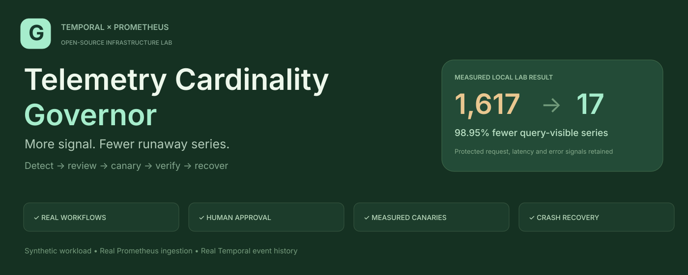
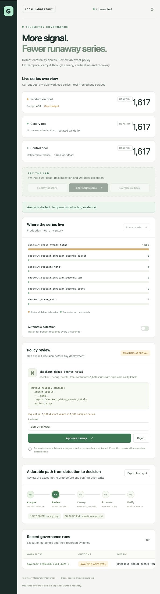
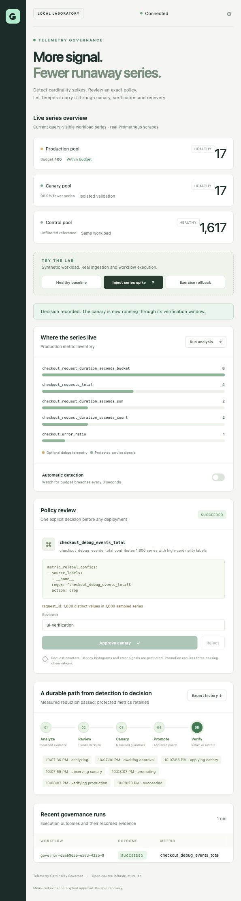
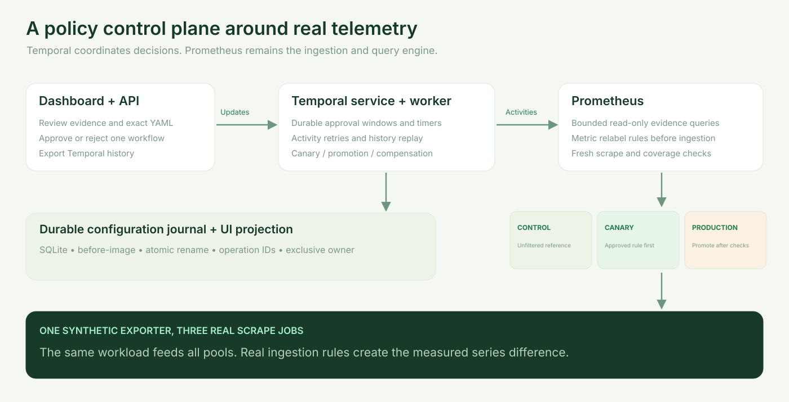
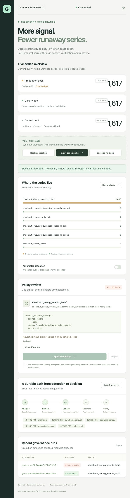
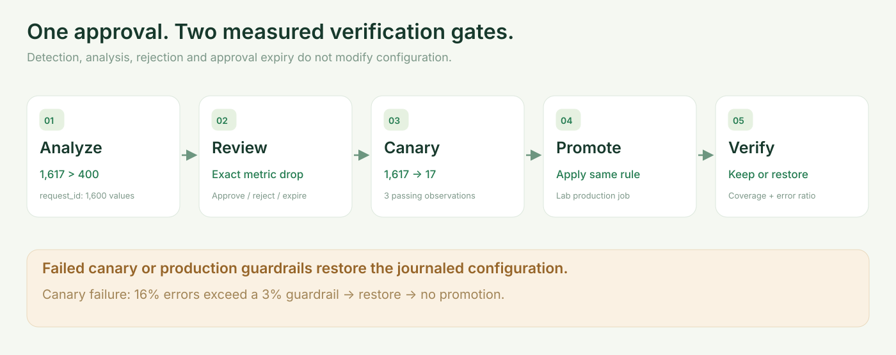
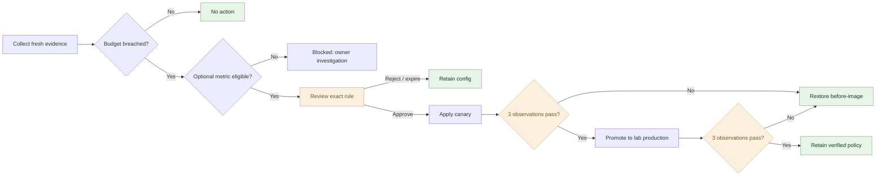
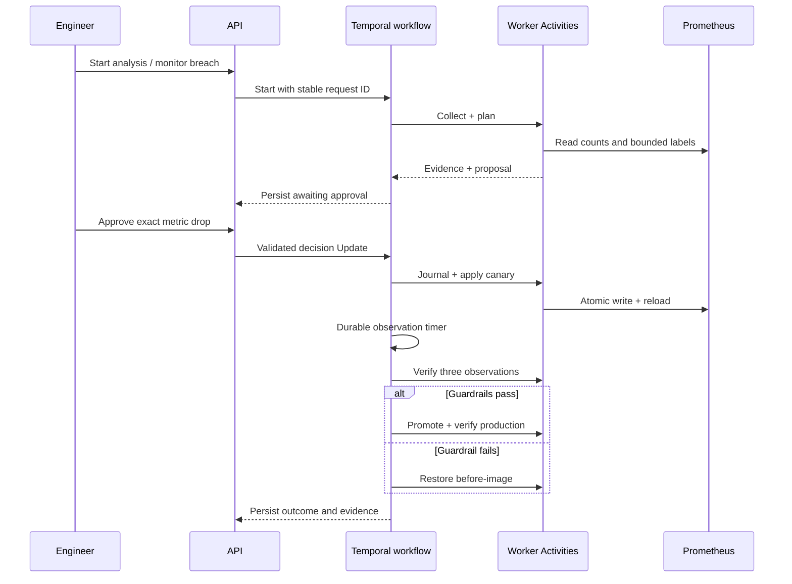

<p align="center">
  
</p>

<p align="center">
  <a href="https://github.com/sivalinb/telemetry-cardinality-governor/actions/workflows/ci.yml"></a>
  
  
  
  <a href="LICENSE"></a>
</p>

**An end-to-end telemetry governance lab that detects a cardinality breach, proposes an exact metric drop, waits for approval, deploys a canary, and promotes or restores the configuration using real Temporal workflows and real Prometheus scrapes.**

Built for infrastructure engineers interested in durable waits, bounded evidence, idempotent effects, concurrent ownership, measured validation and worker crash recovery. No LLM key or paid cloud account is required.

The included **workload is synthetic**. Its exposition, Prometheus ingestion, configuration reloads, Temporal event history and recovery are real. “Production” below names an isolated **lab scrape pool**, not an external fleet.

## Explore

[Quick start](#quick-start) · [Dashboard](#live-dashboard) · [Architecture](#architecture) · [Scenarios](#try-the-scenarios) · [Temporal design](#temporal-design) · [Tests](#verification) · [API](#api-reference) · [Existing telemetry](#observe-existing-telemetry) · [Operations](#operations-and-recovery)

## The problem

A developer adds a `request_id` label to an optional debug counter. Each request creates a new label set, and the counter starts dominating ingestion. An alert identifies the breach, but the response still needs an owner, a precise change, a measured canary, protected service visibility and a recovery plan.

This project implements that complete response. The mitigation drops an explicitly optional metric family by exact name. **Removing a label from existing series can collapse distinct series into duplicates**, so the governor uses an exact metric drop instead. The durable source fix is to redesign instrumentation with bounded dimensions and retain request-level detail in logs or traces.

## Quick start

### Native local lab — macOS or Linux

Prerequisites: **Python 3.11+**, first-run access to PyPI/GitHub, and free ports 8000, 7233, 8233 and 9090.

```bash
git clone https://github.com/sivalinb/telemetry-cardinality-governor.git
cd telemetry-cardinality-governor
python3 -m venv .venv
source .venv/bin/activate
python -m pip install -c requirements.lock -e '.[dev]'
governor local
```

The launcher fetches official Temporal CLI **1.9.1** and Prometheus **3.15.0** releases, verifies their published SHA-256 checksums, extracts only executables, starts four local processes and persists state under `.runtime/`. Subsequent starts reuse the binaries. [`requirements.lock`](requirements.lock) pins the verified Python dependencies and is also used by CI and the container build.

| Interface | URL | Purpose |
|---|---|---|
| Dashboard | [localhost:8000](http://127.0.0.1:8000) | Live evidence, approval and outcomes |
| Temporal UI | [localhost:8233](http://127.0.0.1:8233) | Workflow execution and event history |
| Prometheus | [localhost:9090](http://127.0.0.1:9090) | Real queries and scrape targets |
| API documentation | [localhost:8000/docs](http://127.0.0.1:8000/docs) | OpenAPI reference |

Automatic detection is enabled by `local`. Use `governor local --no-monitor` for manual analysis. `Ctrl+C` stops the stack while retaining state. Alternate ports and independent data directories are supported:

```bash
governor local --runtime-dir .runtime-alt \
  --port 18000 --temporal-port 17233 --ui-port 18233 --prometheus-port 19090
```

### Docker Compose

Prerequisite: Docker with Compose v2.

```bash
docker compose up --build -d --wait
```

Open the same URLs. The distribution includes configuration initialization, Temporal, the API/exporter, a worker and Prometheus. Named volumes persist execution, configuration and telemetry data. Published ports bind to loopback.

```bash
docker compose logs -f worker
docker compose down
```

Stopping preserves volumes. Restart the stack to resume pending workflows. The reproducible lab uses Temporal's development server.

## Live dashboard

Measured pool counts, exact policy YAML, bounded label evidence, named approve/reject decisions, workflow phases and downloadable Temporal history are available in one responsive dashboard.



The unfiltered control remains at 1,617 series after successful verification; canary and lab production retain 17 protected series:



## Architecture



| Component | Responsibility | Source |
|---|---|---|
| Exporter | Bounded or exploding synthetic checkout workload | [`exporter.py`](src/governor/exporter.py) |
| Evidence reader | Metric counts, bounded label sample and freshness | [`prometheus.py`](src/governor/prometheus.py) |
| Analysis | Budgets, allowlist and transparent exact-match proposal | [`analysis.py`](src/governor/analysis.py) |
| Workflow | Approval, durable timers, retries and compensation | [`workflow.py`](src/governor/workflow.py) |
| Deployer | Journaled atomic configuration writes and reloads | [`policies.py`](src/governor/policies.py) |
| Projection | Reports, operation IDs and exclusive configuration ownership | [`store.py`](src/governor/store.py) |
| API and UI | Scenarios, detection, decisions and history export | [`api.py`](src/governor/api.py), [`static/`](src/governor/static/) |

Three scrape jobs read the same underlying workload:

- **Control:** the unfiltered reference.
- **Canary:** receives the approved rule first.
- **Lab production:** receives it only after the canary passes.

A contemporaneous reference reduces the risk of attributing an unrelated workload change to the policy.

## Try the scenarios

### Healthy baseline

Click **Healthy baseline** and wait for fresh scrapes. The workload exposes **29 series**, below the default budget of 400. A manual analysis finishes as `no_action`; no policy operation is journaled.

### Series explosion → approval → promotion

1. Click **Inject series spike**. Manual analysis pauses briefly while scrapes settle.
2. Automatic detection starts an investigation; with monitoring paused, click **Run analysis**.
3. Review the evidence: the optional counter contributes 1,600 of 1,617 series, with 1,600 sampled `request_id` values.
4. Review this exact rule, enter a reviewer name, and click **Approve canary**:

```yaml
metric_relabel_configs:
  - source_labels: [__name__]
    regex: ^checkout_debug_events_total$
    action: drop
```

5. Temporal waits for fresh scrapes and three passing observations.
6. The worker promotes the same rule to lab production and repeats verification.
7. The outcome records **1,617 → 17 query-visible series: a measured 98.95% reduction**.

| Retained protected signal | Series |
|---|---:|
| Request counters | 4 |
| Duration histogram buckets | 8 |
| Duration sum | 2 |
| Duration count | 2 |
| Error ratio | 1 |
| **Total** | **17** |

This percentage describes the bounded synthetic workload. At the two-second demo scrape interval, removing 1,600 series avoids approximately **69.12 million additional samples/day** if the workload persists. Actual storage bytes and financial savings depend on compression, retention, scrape rate and deployment.

### Reject or let approval expire

Click **Reject** during review, or wait for the five-minute deadline. The outcome is `rejected` or `expired`, with **no configuration write** and an empty operation journal.

### Canary failure → rollback

Click **Exercise rollback**, then approve. The canary exposes a measured synthetic error ratio of **16%**, above the **3%** ceiling. Series reduction alone cannot pass: Temporal restores the journaled configuration and skips promotion.



### Kill the worker during observation

Approve an explosion, wait for `observing_canary`, and stop only this lab's worker from another terminal:

```bash
python - <<'PY'
import json, os, signal
with open('.runtime/processes.json') as stream:
    worker = json.load(stream)['worker']
os.kill(worker, signal.SIGKILL)
PY
```

The native supervisor starts a replacement worker, which resumes the same Temporal workflow. Completed Activities are not re-executed during history replay. If a configuration operation's completion was lost, its prepared journal entry allows a retry against the same configuration bytes.

For Compose, use `docker compose restart worker`. This keeps the persisted Temporal service running.

## Policy control loop





Both verification gates require:

- Fresh healthy scrapes in reference and candidate pools.
- Absence of the offending metric from candidate ingestion.
- At least 25% fewer series relative to contemporaneous control.
- Identical protected metric series coverage between pools.
- A finite error ratio between zero and 3%.
- Three consecutive passing observations after an eight-second settling window.

These are narrow lab checks: equal series coverage does not prove semantic equivalence, and a single error-ratio gauge is not a complete service SLO.

## Temporal design

**Workflows own execution state; Activities own side effects.** HTTP, SQLite, filesystem mutations and reloads stay outside deterministic workflow code. The dashboard reads a durable SQLite projection; decisions arrive through validated Temporal Updates.



### Idempotency and ownership

Activities can run more than once after timeouts or a lost acknowledgment. Configuration effects use:

1. Stable IDs: `<workflow_id>:canary`, `:promote`, `:restore`.
2. A SQLite before/after image committed **before** any configuration mutation.
3. A process-shared file lock around preparation, replacement and reload.
4. A flushed temporary file, atomic rename and directory fsync.
5. Comparison with known configuration versions on retry.
6. An `applied` marker recorded only after successful reload.
7. A SQLite lease permitting one active owner of the managed config.

Repeated completed `request_id` values return the existing report. Concurrent starts return the active workflow instead of another config owner. API crashes between reservation and dispatch are reconciled with the same workflow ID. Unknown external config changes produce a conflict and are preserved.

If restoration fails, `rollback_failed` retains ownership for manual recovery; another run cannot silently take over the unresolved configuration.

### Evidence bounds and terminology

- Aggregate counts measure current query-visible workload series at one evaluation time.
- `topk(2000, ...)` bounds returned raw series evidence to 2,000. It does not bound the cost of Prometheus evaluating the query.
- Label cardinalities are exact within the sample and lower bounds when the metric exceeds it.
- Reports retain dimension names/counts, not raw request IDs.
- Freshness comes from the `up` scrape timestamp; unhealthy or stale evidence cannot verify a policy.
- Dropped metrics disappear from current results after scrape staleness processing. Historical blocks and head allocation do not immediately disappear. **No immediate disk-reclamation claim is made.**
- The monitor polls every three seconds with a 60-second cooldown after a completed run. Approval remains mandatory.

## Verification

```bash
python -m pip install -c requirements.lock -e '.[dev]'
ruff check .
ruff format --check .
governor fetch-binaries
GOVERNOR_RUN_E2E=1 pytest -q
```

Without the explicit E2E flag, data-plane tests are skipped. Temporal integration tests require the fetched CLI. Real-stack tests choose free ports and use an isolated temporary directory, so they can run beside the dashboard.

| Layer | Checks |
|---|---|
| Analysis | Budgets, allowlist/protected precedence, label dimensions, invalid errors and missing coverage |
| Durable store | Concurrent ownership, request deduplication and held lease after failed restoration |
| Deployer | Canary isolation, repeated effects, crash after file write, restoration and external-change preservation |
| API | Validation, optional token, cross-origin rejection, observe boundaries and active-run reset prevention |
| Real Temporal | Approve, reject, expire, failed canary/production, compensation and deterministic history replay |
| Real data plane | Measured 1,617 → 17, no-write rejection, error-triggered restoration, SIGKILL recovery and monitoring |
| Distribution | CI starts Docker Compose and measures approval-to-promotion |

Workflow contract tests use labeled evidence fixtures on a real Temporal service. The separate E2E tests use actual Prometheus ingestion. See the [local verification record](docs/evidence/VERIFICATION.md), [JUnit report](docs/evidence/test-results.xml), and [CI runs](https://github.com/sivalinb/telemetry-cardinality-governor/actions).

## API reference

| Method | Endpoint | Purpose |
|---|---|---|
| GET | `/healthz` | API liveness and mode |
| GET | `/api/state` | Measured snapshots, settings and recent reports |
| POST | `/api/scans` | Start/deduplicate with `request_id` |
| GET | `/api/reports/{id}` | Evidence, timeline and operation summary |
| POST | `/api/reports/{id}/decision` | Validated approve/reject Update |
| GET | `/api/reports/{id}/history` | Download actual Temporal history JSON |
| POST | `/api/monitor` | Enable/pause breach detection |
| POST | `/api/lab/scenario` | Reset owned lab config and switch synthetic workload |
| GET | `/lab/metrics/{pool}` | Workload exposition for real Prometheus scrapes |
| GET | `/metrics` | Governor state metrics from its retained report projection |

```bash
curl -sS http://127.0.0.1:8000/api/scans \
  -H 'Content-Type: application/json' \
  -d '{"request_id":"investigation-001"}'
```

After `governor-investigation-001` reaches review:

```bash
curl -sS http://127.0.0.1:8000/api/reports/governor-investigation-001/decision \
  -H 'Content-Type: application/json' \
  -d '{"approved":true,"reviewer":"local-engineer","comment":"Reviewed optional metric and guardrails"}'
```

Decisions require a nonempty reviewer, an active review phase and no prior decision. The reviewer name is an audit field, not an authenticated identity; a deployment beyond this lab needs identity-aware approval.

## Observe existing telemetry

The reader can query an existing Prometheus job, optionally with a bearer token. Launch the API and worker separately in **observe mode**:

```bash
export GOVERNOR_MODE=observe
export PROMETHEUS_URL=https://your-prometheus.example
export PROMETHEUS_PRODUCTION_JOB=your-checkout-job
export GOVERNOR_OPTIONAL_METRICS='["checkout_debug_events_total"]'
export GOVERNOR_SERIES_BUDGET=10000
# Set PROMETHEUS_BEARER_TOKEN in the environment if required.
# Set TEMPORAL_ADDRESS to a separately running Temporal service.
governor serve
# Another terminal with the same settings:
governor worker
```

The current contract expects `checkout_error_ratio` in [0,1], the configured optional metric and the documented protected checkout metrics, with scrapes newer than 15 seconds. For another service, extend the evidence and guardrail contract deliberately; changing only a job name does not make arbitrary telemetry compatible.

Observe mode disables the synthetic exporter, scenario writes and policy deployment. Actionable evidence is recorded as `blocked` with a proposed rule and explanation. The mutable backend is restricted to loopback or the Compose `prometheus` service and exactly the three owned lab scrape jobs.

## Configuration

Native commands read environment variables directly; `.env` is not automatically loaded. See [`.env.example`](.env.example).

| Variable | Default | Meaning |
|---|---|---|
| `GOVERNOR_MODE` | `lab` | `lab` / `observe` |
| `GOVERNOR_RUNTIME_DIR` | `.runtime` | Configuration, SQLite, logs and native state |
| `PROMETHEUS_URL` | `http://127.0.0.1:9090` | Query endpoint; lab reload target |
| `PROMETHEUS_PRODUCTION_JOB` | `governor-production` | Evidence job |
| `PROMETHEUS_BEARER_TOKEN` | empty | Optional read credential |
| `TEMPORAL_ADDRESS` | `127.0.0.1:7233` | Temporal frontend |
| `TEMPORAL_NAMESPACE` | `default` | Workflow namespace |
| `TEMPORAL_TASK_QUEUE` | `cardinality-governor` | Worker queue |
| `GOVERNOR_SERIES_BUDGET` | `400` | Workload series budget |
| `GOVERNOR_OPTIONAL_METRICS` | debug counter JSON list | Eligible metric allowlist |
| `GOVERNOR_APPROVAL_TIMEOUT` | `300` | Decision deadline in seconds |
| `GOVERNOR_OBSERVATION_SECONDS` | `8` | Scrape settling window |
| `GOVERNOR_MONITOR` | `false` | Background detector; native `local` enables it |
| `GOVERNOR_API_TOKEN` | empty | Optional API bearer token |

Set `GOVERNOR_API_TOKEN` before starting a protected native lab, then enter it through the dashboard gear button or use an Authorization header. The browser retains the token only in session storage. Compose uses anonymous loopback lab defaults.

## Operations and recovery

Persist **both** Temporal execution state and the configuration journal. Native state is in `.runtime/`; Compose uses named volumes. The journal and Temporal history serve different recovery purposes.

| Symptom | Inspect / act |
|---|---|
| Dashboard has no series | Wait for the first scrape; inspect Prometheus `/targets` and API logs |
| Workflow queued | Check frontend/worker queue; API retries queued starts with the same ID |
| Awaiting review | Approve/reject; default expiry is five minutes |
| Canary rolled back | Read coverage, reduction and error evidence; control stays unfiltered |
| Configuration conflict | Inspect external changes; unknown bytes are preserved |
| `rollback_failed` | Pause monitoring, preserve the journal, inspect reload/config health; ownership stays held |
| Worker exited | Supervisor/Compose restart it; timers and approvals remain durable |
| Temporal/server exited | Restart against the same directory/volumes |
| Port collision | Use alternate launcher ports or adjust Compose mappings |

For failed restoration, preserve the before-image in `operations`, inspect the actual loaded Prometheus config, recover the intended bytes under the same ownership lock, and verify reload/service health before reconciling the report and releasing ownership. There is no force-unlock button.

The implementation scope is a local development Temporal service, loopback demo, fixed checkout guardrails, shared-filesystem ownership and one managed config. A fleet deployment requires a production Temporal service, authenticated approvers, service-specific SLOs, distributed deployment ownership, audit retention and an adapter for its configuration delivery system.

## Repository map

```text
src/governor/
  workflow.py       Approval, durable orchestration and compensation
  activities.py     External operations registered with the worker
  prometheus.py     Read-only evidence collector
  analysis.py       Budget, proposal and verification rules
  policies.py       Journaled config delivery and compare-and-swap
  store.py          SQLite projection, ownership and operation records
  exporter.py       Synthetic workload exposition
  api.py            API, monitoring and history export
  cli.py            Native launcher and process supervision
  binaries.py       Official downloads and SHA-256 checks
  static/           Responsive dashboard with no frontend build step
tests/              Unit, real Temporal, replay and data-plane tests
docs/images/        Editable diagrams and running-app screenshots
docs/evidence/      Verification record and JUnit report
scripts/            Illustration generator and Compose smoke check
compose.yml         Persisted container distribution
.github/workflows/  Native tests and Compose verification
```

## Develop and extend

```bash
ruff check .
ruff format .
python scripts/illustrate.py
```

Potential extensions: cardinality trends, growth-rate detection, multiple service budgets, source-instrumentation repair proposals, authenticated approval identities, Git-based policy delivery and an OpenTelemetry Collector adapter. Preserve bounded evidence, explicit approval, measured guards and recoverable effects.

## References

- [Temporal Python SDK](https://docs.temporal.io/develop/python)
- [Activity idempotency](https://docs.temporal.io/activity-definition#idempotency)
- [Signals, Queries and Updates](https://docs.temporal.io/encyclopedia/workflow-message-passing)
- [Persistent development server](https://docs.temporal.io/cli/command-reference/server)
- [Prometheus query API](https://prometheus.io/docs/prometheus/latest/querying/api/)
- [Metric relabeling and label uniqueness](https://prometheus.io/docs/prometheus/latest/configuration/configuration/#metric_relabel_configs)

## License

[MIT](LICENSE). Created by Siva Babu as a public infrastructure engineering lab.
